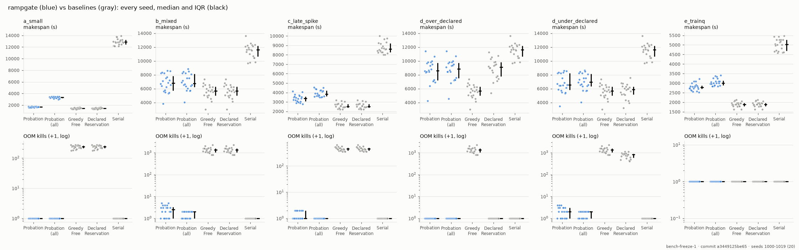
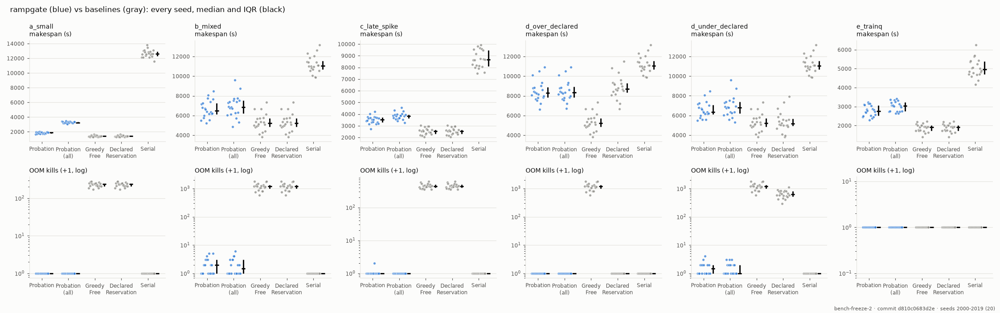

# rampgate

> *ramp* + *gate*: hold each job's warm-up ramp at the gate, measure what it really uses, then reserve exactly that.

rampgate is an **observation-based admission scheduler** packaged as a small, embeddable, pure-Python library
(zero runtime dependencies in the core). It decides **when** a job may start on a device the caller chose:

- **Probation:** at most one warming job per device, so ramp-ups never race.
- **Observed-peak reservation:** reserve `observed_peak × safety_margin`, growing if the peak grows.
- **OOM feedback:** an OOM grows the estimate and re-queues the job to resume from its checkpoint.

**The trade-off (simulated, held-out set 2).** Safety is not free; rampgate makes it cheaper than the alternatives. In the six simulated scenarios it has no OOMs except a few first-contact ones (a median of 0–1 per run, all in cold runs), and it finishes in 0.12–0.75× the makespan of `Serial`, the other strategy that is always OOM-free. The price is makespan: against `GreedyFree`, which OOMs hundreds of times per run in five of the six scenarios, warm rampgate takes 1.07–1.59× as long. It misses its own ≤ 1.2× target in four of six. In the TrainQ-like scenario (e) no strategy OOMs, so rampgate's 1.13–1.20× makespan buys nothing there; this scenario likely has too little memory pressure. See [the price of safety](#summary-the-price-of-safety).

All benchmark results are from rampgate's deterministic simulator. Demonstrated (not benchmarked) on one laptop GPU (RTX 4050, 6 GB) with synthetic memory-hog containers: probation, a Rule V vacate and an OOM→Rule O cycle, checked by script. Not yet tested: multiple GPUs, gang jobs, CPU devices, a real framework's caching allocator, orchestrator restart, sub-second spikes. See [docs/real-run/assumptions.md](docs/real-run/assumptions.md) for what the real runs confirmed and contradicted.

**Status:** pre-alpha (model, reducer, `decide`, policies, estimators, `Engine` with persistence, the simulator, and the `rampgate-nvml`, `rampgate-psutil` and `rampgate-docker` adapters). L4 gates: failed on the first held-out evaluation (freeze-1, 6 OOMs); met on the second held-out set (freeze-2, seeds 2000–2019) after the fixes listed in Methodology. Not on PyPI yet.

## Quickstart

```sh
pip install rampgate
```

```python
from rampgate import Device, FifoPolicy, Job, MarkStable, Resources, Start
from rampgate.sim import RampPlateau, Scenario, SimJob, simulate

gpu = Device("gpu0", Resources(vram=24))  # GB here; any unit works
ramp = RampPlateau(load_s=20, ramp_s=40, plateau=Resources(vram=9), duration_s=300)
jobs = tuple(SimJob(Job(f"train-{i}", {"gpu0": None}), ramp, submit_at=0) for i in range(3))

trace = simulate(Scenario((gpu,), jobs), FifoPolicy(), max_time=3000)
for tick in trace.ticks:
    for action in tick.decision.actions:
        if isinstance(action, Start | MarkStable):
            print(f"t={tick.now:5.0f}  {type(action).__name__:10} {action.job_id}")
print("OOM kills:", trace.world.oom_count, " finished at t =", trace.ticks[-1].now)
```

Three jobs ramp one at a time (probation) and are reserved at their observed peaks. The third has no history, so it starts in the room that is left, is OOM-killed once (a first-contact OOM), and resumes from its checkpoint once it really fits. With real devices, drive the same `Engine` from your own loop: see [docs/integrating.md](docs/integrating.md) and `examples/docker_gpu_queue.py`.

## Packages

| Distribution | Purpose |
|---|---|
| `rampgate` | Core: model, reducer, decide, policies, estimators, Engine, simulator. Stdlib only. |
| `rampgate-nvml` | NVIDIA GPU probe; process → container mapping via `/proc/<pid>/cgroup` |
| `rampgate-psutil` | Host RAM/CPU probe; process-tree usage |
| `rampgate-docker` | Docker executor, exit classification, event watcher, usage mapper |

## Benchmark

Simulated GPU cluster, six scenarios ([Simulator](docs/simulator.md)): (a) small jobs, (b) a mixed queue, (c) a late eval spike, (d_over) over-declared hints, (d_under) under-declared hints, (e) a training queue. rampgate's rows (`Probation`, cold and warm history) are compared with three baselines: `GreedyFree` (start whenever free memory looks sufficient), `DeclaredReservation` (reserve the declared hint) and `Serial` (one job per device). The acceptance criteria (the L4 gates) were fixed before measuring. Every OOM of a rampgate row that is not a **first-contact** OOM (an OOM next to a first-attempt job that is still ramping and has no observation-based estimate) counts as a bug. No job may be OOM-killed twice on the same device.

Each table comes from a single run on **held-out seeds**, made once on a frozen git tag. The numbers are generated from the committed `results.json` (`docs/benchmark/freeze-N/heldout/`), which also holds the ablation, sensitivity and `trusted_margin` tables and the plots. The pre-registration of both freezes is kept in a private design document; see [Methodology](#methodology).

### Summary: the price of safety

Freeze 2, held-out set 2 (seeds 2000–2019), from `docs/benchmark/freeze-2/heldout/results.json`. Ratios are per seed (each strategy on the same seed), shown as median [Q1–Q3] over the 20 seeds. Freeze 1 failed its gates and stays the primary result (below). This summary describes the configuration that passed.


**Among OOM-free strategies: rampgate vs `Serial`** (makespan ratio, lower is better):

| Scenario | cold Probation / Serial | warm Probation / Serial |
|---|---|---|
| a_small | 0.15 [0.14–0.15] | 0.12 [0.12–0.12] |
| b_mixed | 0.60 [0.56–0.65] | 0.59 [0.54–0.61] |
| c_late_spike | 0.41 [0.39–0.42] | 0.37 [0.35–0.38] |
| d_over_declared | 0.75 [0.73–0.78] | 0.75 [0.73–0.78] |
| d_under_declared | 0.59 [0.56–0.63] | 0.59 [0.54–0.61] |
| e_trainq | 0.55 [0.53–0.57] | 0.44 [0.41–0.47] |

`DeclaredReservation` is also OOM-free when hints are over-declared (`d_over_declared`). There, cold `Probation` takes 0.95 [0.93–1.00]× its makespan.

**The price of safety: rampgate vs `GreedyFree` and `DeclaredReservation`.** Makespan ratio, OOM kills and lost work side by side. The "first-contact" column counts OOMs next to a still-ramping job with no observation-based estimate, which is the only kind rampgate is allowed.

| Scenario | Strategy | Makespan / GreedyFree | OOMs / run | of which first-contact | Lost work (step-s) |
|---|---|---|---|---|---|
| a_small | Probation | 1.31 [1.27–1.37] | 0 [0–0] | 0 [0–0] | 0 [0–0] |
| a_small | Probation (warm) | 1.07 [1.03–1.13] | 0 [0–0] | 0 [0–0] | 0 [0–0] |
| a_small | GreedyFree | 1.00 [1.00–1.00] | 237 [209–245] | 64 [63–65] | 3,037 [2,938–3,261] |
| a_small | DeclaredReservation | 1.00 [1.00–1.00] | 237 [209–245] | 64 [63–65] | 3,037 [2,938–3,261] |
| b_mixed | Probation | 1.27 [1.17–1.34] | 1 [0–2] | 1 [0–2] | 46 [0–122] |
| b_mixed | Probation (warm) | 1.28 [1.12–1.35] | 0 [0–0] | 0 [0–0] | 0 [0–0] |
| b_mixed | GreedyFree | 1.00 [1.00–1.00] | 1,192 [995–1,330] | 99 [88–114] | 13,647 [10,968–15,546] |
| b_mixed | DeclaredReservation | 1.00 [1.00–1.00] | 1,192 [995–1,330] | 99 [88–114] | 13,647 [10,968–15,546] |
| c_late_spike | Probation | 1.41 [1.29–1.45] | 0 [0–0] | 0 [0–0] | 0 [0–0] |
| c_late_spike | Probation (warm) | 1.28 [1.22–1.32] | 0 [0–0] | 0 [0–0] | 0 [0–0] |
| c_late_spike | GreedyFree | 1.00 [1.00–1.00] | 438 [400–490] | 144 [134–149] | 4,602 [4,002–5,083] |
| c_late_spike | DeclaredReservation | 1.00 [1.00–1.00] | 438 [400–490] | 144 [134–149] | 4,602 [4,002–5,083] |
| d_over_declared | Probation | 1.59 [1.52–1.74] | 0 [0–0] | 0 [0–0] | 0 [0–0] |
| d_over_declared | Probation (warm) | 1.59 [1.52–1.72] | 0 [0–0] | 0 [0–0] | 0 [0–0] |
| d_over_declared | GreedyFree | 1.00 [1.00–1.00] | 1,192 [995–1,330] | 99 [88–114] | 13,647 [10,968–15,546] |
| d_over_declared | DeclaredReservation | 1.65 [1.60–1.75] | 0 [0–0] | 0 [0–0] | 0 [0–0] |
| d_under_declared | Probation | 1.21 [1.15–1.34] | 0 [0–1] | 0 [0–1] | 18 [0–55] |
| d_under_declared | Probation (warm) | 1.28 [1.12–1.35] | 0 [0–0] | 0 [0–0] | 0 [0–0] |
| d_under_declared | GreedyFree | 1.00 [1.00–1.00] | 1,192 [995–1,330] | 99 [88–114] | 13,647 [10,968–15,546] |
| d_under_declared | DeclaredReservation | 1.00 [0.94–1.05] | 624 [530–800] | 82 [62–92] | 10,058 [8,582–11,062] |
| e_trainq | Probation | 1.50 [1.43–1.56] | 0 [0–0] | 0 [0–0] | 0 [0–0] |
| e_trainq | Probation (warm) | 1.20 [1.05–1.25] | 0 [0–0] | 0 [0–0] | 0 [0–0] |
| e_trainq | GreedyFree | 1.00 [1.00–1.00] | 0 [0–0] | 0 [0–0] | 0 [0–0] |
| e_trainq | DeclaredReservation | 1.00 [1.00–1.00] | 0 [0–0] | 0 [0–0] | 0 [0–0] |

How to read it:
- In (a)–(d), rampgate's extra makespan buys removing hundreds to about a thousand OOM kills per run and thousands of step-seconds of lost work.
- In `e_trainq`, `GreedyFree` has no OOMs either, so rampgate's extra makespan (1.20× warm, 1.50× cold) buys nothing there.
- In `d_over_declared`, rampgate and the OOM-free `DeclaredReservation` both take about 1.6× `GreedyFree`'s makespan, and rampgate is slightly faster (0.95×).

**Target (reported, not a gate): warm `Probation` median makespan ≤ 1.2 × `GreedyFree` median makespan** (ratio of medians, so it differs slightly from the per-seed ratios above). Missed in four of six scenarios on freeze 2, and in two of six on freeze 1:

| Scenario | Freeze 1 (seeds 1000–1019) | Freeze 2 (seeds 2000–2019) |
|---|---|---|
| a_small | 1.09 (met) | 1.10 (met) |
| b_mixed | 1.18 (met) | 1.27 (**missed**) |
| c_late_spike | 1.31 (**missed**) | 1.29 (**missed**) |
| d_over_declared | 1.56 (**missed**) | 1.58 (**missed**) |
| d_under_declared | 1.18 (met) | 1.27 (**missed**) |
| e_trainq | 1.17 (met) | 1.13 (met) |

The two columns come from different seed sets, so the difference between them is not a measured cost of the freeze-2 changes. On the development seeds 0–49 the freeze-2 values are 1.08 / 1.30 / 1.30 / 1.66 / 1.30 / 1.15.

### Freeze 1 (held-out set 1): failed

The primary result. `--check` **failed** on 6 runs: 6 OOMs of cold `Probation` that are not first-contact, 2 in (b) on seeds 1002 and 1008 and 4 in (c) on seeds 1005, 1009, 1013 and 1016 (in bold below). Diagnosis: [`docs/benchmark/freeze-1/heldout-failures.md`](docs/benchmark/freeze-1/heldout-failures.md).

Seeds 1000–1019 (20), tag `bench-freeze-1`, commit `53be4cd` (originally `a344912`, see Methodology). Cells: median [Q1–Q3] over seeds; OOM columns other than the median are totals over all seeds.

| Scenario | Strategy | Makespan (s) | OOMs / run | First-contact OOMs (total) | Other OOMs (total) | Repeat-device OOMs (total) | Lost work (step-s) |
|---|---|---|---|---|---|---|---|
| a_small | Probation | 1,691 [1,632–1,740] | 0 [0–0] | 0 | 0 | 0 | 0 |
| a_small | Probation (warm) | 1,570 [1,492–1,602] | 0 [0–0] | 0 | 0 | 0 | 0 |
| a_small | GreedyFree | 1,436 [1,365–1,505] | 242 [216–259] | 1,240 | 3,472 | 287 | 3,233 |
| a_small | DeclaredReservation | 1,436 [1,365–1,505] | 242 [216–259] | 1,240 | 3,472 | 287 | 3,233 |
| a_small | Serial | 12,860 [12,466–13,233] | 0 [0–0] | 0 | 0 | 0 | 0 |
| b_mixed | Probation | 6,792 [5,745–7,830] | 2 [0–2] | 29 | **2** | 0 | 80 |
| b_mixed | Probation (warm) | 6,700 [5,747–7,562] | 0 [0–0] | 0 | 0 | 0 | 0 |
| b_mixed | GreedyFree | 5,694 [5,019–6,266] | 1,330 [1,038–1,584] | 2,061 | 24,823 | 340 | 14,844 |
| b_mixed | DeclaredReservation | 5,694 [5,019–6,266] | 1,330 [1,038–1,584] | 2,061 | 24,823 | 340 | 14,844 |
| b_mixed | Serial | 11,630 [10,646–12,166] | 0 [0–0] | 0 | 0 | 0 | 0 |
| c_late_spike | Probation | 3,370 [3,062–3,585] | 0 [0–1] | 3 | **4** | 0 | 0 |
| c_late_spike | Probation (warm) | 3,308 [3,118–3,592] | 0 [0–0] | 0 | 0 | 0 | 0 |
| c_late_spike | GreedyFree | 2,528 [2,416–2,787] | 446 [388–492] | 2,901 | 6,132 | 262 | 4,419 |
| c_late_spike | DeclaredReservation | 2,528 [2,416–2,787] | 446 [388–492] | 2,901 | 6,132 | 262 | 4,419 |
| c_late_spike | Serial | 8,599 [8,291–9,204] | 0 [0–0] | 0 | 0 | 0 | 0 |
| d_over_declared | Probation | 8,574 [7,226–9,726] | 0 [0–0] | 0 | 0 | 0 | 0 |
| d_over_declared | Probation (warm) | 8,860 [7,282–9,726] | 0 [0–0] | 0 | 0 | 0 | 0 |
| d_over_declared | GreedyFree | 5,694 [5,019–6,266] | 1,330 [1,038–1,584] | 2,061 | 24,823 | 340 | 14,844 |
| d_over_declared | DeclaredReservation | 9,108 [7,788–9,844] | 0 [0–0] | 0 | 0 | 0 | 0 |
| d_over_declared | Serial | 11,630 [10,646–12,166] | 0 [0–0] | 0 | 0 | 0 | 0 |
| d_under_declared | Probation | 6,521 [5,835–8,252] | 1 [0–2] | 24 | 0 | 0 | 58 |
| d_under_declared | Probation (warm) | 6,700 [5,747–7,562] | 0 [0–0] | 0 | 0 | 0 | 0 |
| d_under_declared | GreedyFree | 5,694 [5,019–6,266] | 1,330 [1,038–1,584] | 2,061 | 24,823 | 340 | 14,844 |
| d_under_declared | DeclaredReservation | 5,877 [5,140–6,284] | 822 [602–904] | 1,740 | 13,502 | 261 | 12,136 |
| d_under_declared | Serial | 11,630 [10,646–12,166] | 0 [0–0] | 0 | 0 | 0 | 0 |
| e_trainq | Probation | 2,788 [2,700–2,875] | 0 [0–0] | 0 | 0 | 0 | 0 |
| e_trainq | Probation (warm) | 2,206 [2,104–2,350] | 0 [0–0] | 0 | 0 | 0 | 0 |
| e_trainq | GreedyFree | 1,886 [1,801–1,969] | 0 [0–0] | 0 | 0 | 0 | 0 |
| e_trainq | DeclaredReservation | 1,886 [1,801–1,969] | 0 [0–0] | 0 | 0 | 0 | 0 |
| e_trainq | Serial | 5,024 [4,698–5,268] | 0 [0–0] | 0 | 0 | 0 | 0 |



### Freeze 2 (held-out set 2): after held-out evaluation 1

These are the changes made after freeze 1 failed (see Methodology): lower-bound estimates grow by `oom_growth`, an untrusted warming job holds its device (I17), Rule V vacates STABLE jobs when a device is physically overcommitted, and the isolation retry. `--check` **passed**: every rampgate row has 0 OOMs that are not first-contact and 0 repeat-device OOMs, on all 20 seeds. The development seeds 0–49 pass as well ([`docs/benchmark/freeze-2/dev/`](docs/benchmark/freeze-2/dev/results.md)).

Seeds 2000–2019 (20), tag `bench-freeze-2`, commit `c14ffc0` (originally `d810c06`, see Methodology). Cells: median [Q1–Q3] over seeds; OOM columns other than the median are totals over all seeds.

| Scenario | Strategy | Makespan (s) | OOMs / run | First-contact OOMs (total) | Other OOMs (total) | Repeat-device OOMs (total) | Lost work (step-s) |
|---|---|---|---|---|---|---|---|
| a_small | Probation | 1,888 [1,761–1,973] | 0 [0–0] | 0 | 0 | 0 | 0 |
| a_small | Probation (warm) | 1,528 [1,462–1,586] | 0 [0–0] | 0 | 0 | 0 | 0 |
| a_small | GreedyFree | 1,394 [1,336–1,464] | 237 [209–245] | 1,286 | 3,297 | 290 | 3,037 |
| a_small | DeclaredReservation | 1,394 [1,336–1,464] | 237 [209–245] | 1,286 | 3,297 | 290 | 3,037 |
| a_small | Serial | 12,635 [12,328–12,941] | 0 [0–0] | 0 | 0 | 0 | 0 |
| b_mixed | Probation | 6,506 [6,113–7,276] | 1 [0–2] | 22 | 0 | 0 | 46 |
| b_mixed | Probation (warm) | 6,628 [5,873–7,176] | 0 [0–0] | 0 | 0 | 0 | 0 |
| b_mixed | GreedyFree | 5,236 [4,876–5,722] | 1,192 [995–1,330] | 2,053 | 21,626 | 299 | 13,647 |
| b_mixed | DeclaredReservation | 5,236 [4,876–5,722] | 1,192 [995–1,330] | 2,053 | 21,626 | 299 | 13,647 |
| b_mixed | Serial | 11,054 [10,670–11,568] | 0 [0–0] | 0 | 0 | 0 | 0 |
| c_late_spike | Probation | 3,522 [3,304–3,706] | 0 [0–0] | 1 | 0 | 0 | 0 |
| c_late_spike | Probation (warm) | 3,280 [3,003–3,367] | 0 [0–0] | 0 | 0 | 0 | 0 |
| c_late_spike | GreedyFree | 2,550 [2,330–2,670] | 438 [400–490] | 2,847 | 6,137 | 258 | 4,602 |
| c_late_spike | DeclaredReservation | 2,550 [2,330–2,670] | 438 [400–490] | 2,847 | 6,137 | 258 | 4,602 |
| c_late_spike | Serial | 8,657 [8,112–9,484] | 0 [0–0] | 0 | 0 | 0 | 0 |
| d_over_declared | Probation | 8,287 [7,832–8,882] | 0 [0–0] | 0 | 0 | 0 | 0 |
| d_over_declared | Probation (warm) | 8,287 [7,817–8,882] | 0 [0–0] | 0 | 0 | 0 | 0 |
| d_over_declared | GreedyFree | 5,236 [4,876–5,722] | 1,192 [995–1,330] | 2,053 | 21,626 | 299 | 13,647 |
| d_over_declared | DeclaredReservation | 8,712 [8,358–9,269] | 0 [0–0] | 0 | 0 | 0 | 0 |
| d_over_declared | Serial | 11,054 [10,670–11,568] | 0 [0–0] | 0 | 0 | 0 | 0 |
| d_under_declared | Probation | 6,368 [6,115–7,060] | 0 [0–1] | 13 | 0 | 0 | 18 |
| d_under_declared | Probation (warm) | 6,628 [5,873–7,176] | 0 [0–0] | 0 | 0 | 0 | 0 |
| d_under_declared | GreedyFree | 5,236 [4,876–5,722] | 1,192 [995–1,330] | 2,053 | 21,626 | 299 | 13,647 |
| d_under_declared | DeclaredReservation | 5,162 [4,948–5,654] | 624 [530–800] | 1,638 | 11,349 | 225 | 10,058 |
| d_under_declared | Serial | 11,054 [10,670–11,568] | 0 [0–0] | 0 | 0 | 0 | 0 |
| e_trainq | Probation | 2,766 [2,521–3,059] | 0 [0–0] | 0 | 0 | 0 | 0 |
| e_trainq | Probation (warm) | 2,178 [1,911–2,386] | 0 [0–0] | 0 | 0 | 0 | 0 |
| e_trainq | GreedyFree | 1,920 [1,724–2,018] | 0 [0–0] | 0 | 0 | 0 | 0 |
| e_trainq | DeclaredReservation | 1,920 [1,724–2,018] | 0 [0–0] | 0 | 0 | 0 | 0 |
| e_trainq | Serial | 4,957 [4,709–5,375] | 0 [0–0] | 0 | 0 | 0 | 0 |




**Reported, not gated (freeze 2).** For cold `Probation`, summed over the 20 seeds:

| | b_mixed | c_late_spike | d_under_declared |
|---|---|---|---|
| Rule V vacates | 1 | 4 | 3 |
| Isolation wait (total, s) | 12,426 | 576 | 5,921 |
| Runs where Overcommitted fired | 19/20 | 18/20 | 19/20 |

The Overcommitted warning fires in most runs. This is a known v0.2 issue: admission reserves `E × trusted_margin` while a STABLE job reserves `peak × safety_margin`, so devices look overcommitted on paper at `MarkStable` (v0.2 roadmap).

**Limitation of (d), under-declared.** In `d_under_declared`, hints affect only the first job of each template (hints are 0.4–0.7 of the true peak; after that the history max is used). This scenario tests under-declaration only in a narrow window. A scenario where hints stay decisive longer is a v0.2 benchmark candidate (v0.2 roadmap).

## Methodology

**Protocol.** Development and diagnosis use development seeds only (0–9 up to freeze 1, 0–49 since). When `--check` passes on them and every regression test passes, the configuration is frozen as the git tag `bench-freeze-N`. Held-out set N (seeds `1000·N … 1000·N + 19`, warm stores from `10 000 + 1000·N`) has never been run before; it is run **once** on the tag. A failed criterion is not relaxed. Its result stays as it is, its failures may be diagnosed on their traces, and the failing (scenario, seed) pairs become regression tests. A held-out set is never reported again after it is spent. The tag is made before its run and published at release.

**Pre-registration.** The pre-registration (acceptance criteria, change notes, freeze protocol) lives in a private design document. The repository history was rewritten on 2026-10-29 before first publication to remove it. The original history is kept in a private archive; original freeze commits: `bench-freeze-1` `a3449125be65812bbbb9245908466ccfc79f33c1`, `bench-freeze-2` `d810c0683d2e254031727ec92375382fe0bdf471`. It can be shared with reviewers on request; these hashes prove that an archive shared later wasn't altered, but not when the tags were made. Both tags were made locally and not published before their results were read, so the timing is not independently verifiable.

| | `bench-freeze-1` | `bench-freeze-2` |
|---|---|---|
| Tag → commit | `40cd68a` → `53be4cd` | `4ea5332` → `c14ffc0` |
| Original tag → commit (private archive) | `d32ec95` → `a344912` | `abb4338` → `d810c06` |
| Tag created | 2026-10-27 13:13:35 +03:00 | 2026-10-28 10:32:00 +03:00 |
| Held-out run started | 2026-10-27 13:13:39 +03:00 | 2026-10-28 10:32:05 +03:00 |
| Results first read | 2026-10-27 14:32:52 +03:00 | 2026-10-28 12:23:12 +03:00 |

Until 2026-10-28 the protocol required pushing the tag to GitHub before its run. That rule was dropped while freeze 2's run was in progress, before its results were read, because the project stays local until release.

**Changes made after results were first seen** (the first benchmark results were seen after `c37de39`, 2026-10-21). Hashes are after the history rewrite; *private* marks a commit that changed only the design document and exists only in the original history, under the original hash shown. [History rewrite](docs/benchmark/history-rewrite.md) maps every hash to its original:

*After the first development-seed results, before freeze 1 (2026-10-22):*

| Commit | Change |
|---|---|
| `ad61631` | `HintExceeded` warning when observed usage exceeds the declared hint. |
| `06e63b5` | Clarified "first-contact OOM": a declared hint is not an observation (written after results were seen). |
| `955755e` | Added OOM kills per job and the repeat-OOM gate (a stricter criterion, added after results). |
| private (`5a5a081`) | The L4 gates cover the `main` and `warm` groups; the sensitivity sweep is reported only. |
| `f62cc5c` | Fix: an OOM lower bound alone never makes an estimate trusted. |
| private (`4ccf181`) | Design document for f62cc5c. |
| `a914674` | Changelog for f62cc5c. |
| private (`72de3ca`) | Design document: a separate `trusted_margin` (1.05) for trusted warming jobs. |
| `8597a89` | `Config.trusted_margin` (default 1.05). |
| `80dcba8` | History keeps arrival order, so an older lower bound never overrides a later success. |
| `9ed3e1a` | Bench tooling: `trusted_margin` sweep, Pareto plots, warm-vs-cold diagnosis, `--seed-start` / `--commit`. |
| private (`d7955b0`) | Protocol: development seeds 0–9, held-out seeds 1000–1019, freeze tag. |
| private (`c1629e8`) | Design document for rule A, rationale written before measuring. |
| `53be4cd` | Rule A: `trusted_margin` only with ≥ 3 observations. **Tagged `bench-freeze-1`.** |

*After held-out evaluation 1, before freeze 2 (2026-10-27):*

| Commit | Change |
|---|---|
| `820dbef` | Recorded the freeze-1 held-out results unchanged. |
| `47215ef` | Plots carry tag, commit and seed set and are redrawn from `results.json`. |
| `18dd8cb` | Freeze-1 held-out plots and failure traces. |
| private (`f9e0dee`) | Design document: lower-bound-only estimates grow by `oom_growth`, rationale before measuring. |
| `3b0d6e2` | Lower-bound-only estimates grow by `oom_growth` for admission. |
| private (`61ebe13`) | Design document: an untrusted warming job holds its device against every start (I17). |
| `f64b570` | An untrusted warming job holds its device against every start (I17). |
| `c73f284` | The six freeze-1 held-out failures as regression tests (replayed, not reported). |
| `13a916f` | Protocol: freeze-N, a new held-out set per freeze, development seeds 0–49. |
| private (`732837a`) | Design document: every dimension whose estimate is a lower bound grows (scope widened before measuring). |
| `2867ed7` | Grow every estimate dimension that comes from a lower bound. |
| `8b91a62` | Diagnosis tooling: `--only` pairs, `--all-ooms`. |
| `1fa0e03` | Diagnosis: check that Overcommitted was active at freeze-1's (c) OOMs. |
| private (`61f58bd`) | Design document: Rule V (vacate), isolation retry, I18/I19, I13 exception, new reported metrics, v0.2 roadmap note. |
| private (`101e77e`) | Design document: Rule V vacates STABLE jobs only, triggered by `MarkStable` / `UpdateReservation`. |
| `daa0f59` | Rule V and the isolation retry; state schema v4. |
| `a3fd805` | Report Rule V vacates, isolation wait and Overcommitted warnings (not gated). |
| `c14ffc0` | Development-seed failures found before freeze 2 (b_mixed 36, d_under 36, b_mixed 19) as regression tests. **`bench-freeze-2` after the rewrite.** |
| private (`d810c06`) | Design document roadmap: a v0.2 scenario where hints stay decisive longer. **Originally tagged `bench-freeze-2`** (no code change: the rewritten tag points at its parent `c14ffc0`, same code tree). |

*After held-out evaluation 2:* the freeze-2 results recorded unchanged; the README's benchmark, status and prior-art sections and this Methodology section; the design document's publishing rule and its record of publication, including a correction (it used to say `bench-freeze-1` was pushed after its results; it has never been pushed).

*Before first publication (2026-10-29):* the history was rewritten to remove the design document ([History rewrite](docs/benchmark/history-rewrite.md)). The rewrite changes no code: every commit keeps its tree minus `SPEC.md`. Its follow-up commit changes no behaviour: it replaces the references to `SPEC.md` (in code, only comments, docstrings and benchmark report headings), publishes the invariants as [docs/invariants.md](docs/invariants.md), and maps old commit hashes to new ones. The frozen records keep their original hashes.

## Prior art

rampgate builds on well-known ideas:
- **Limits learned from usage history:** Google's Autopilot and the Kubernetes Vertical Pod Autoscaler.
- **Reclaiming reserved but unused resources:** Borg.
- **Sharing GPUs between deep-learning jobs:** research systems such as Gandiva, Salus and AntMan.

Its contribution is the **combination** of serialized ramp-up (probation), observed-peak reservation and OOM feedback, packaged as a small **embeddable library** with zero runtime dependencies and a deterministic simulator. It is not a cluster manager and does not replace one. It decides only *when* a job may start on a device the caller already chose.

## Development

Everything runs in Docker; nothing needs to be installed on the host.

```sh
./dev build          # build the dev image (uv + CPython 3.11–3.13)
./dev ci             # ruff, mypy --strict, pytest+coverage on 3.11, 3.12, 3.13
./dev ci 3.12        # a single version
./dev zero-deps      # verify the core wheel has no runtime dependencies
./dev shell          # interactive shell with a synced venv
```

## License

Apache-2.0. See [LICENSE](LICENSE) and [NOTICE](NOTICE).
