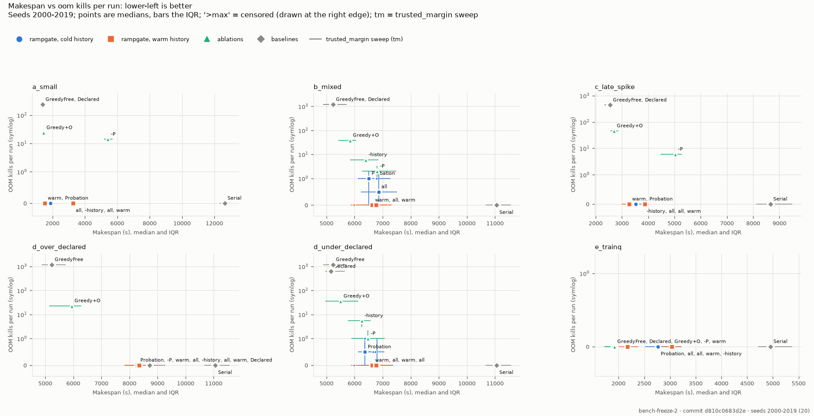

# Benchmark

All benchmark numbers come from rampgate's deterministic simulator. The protocol, every table and the list of changes made after results were seen are in the repository's README ("Benchmark" and "Methodology"). This page summarizes them.

- **Scenarios:** six simulated rows: (a) small jobs, (b) a mixed queue, (c) late eval spikes, (d) over- and under-declared hints, (e) a training queue.
- **Baselines:** `GreedyFree`, `DeclaredReservation`, `Serial`.
- **Held-out evaluation:** each frozen configuration (git tag `bench-freeze-N`) is run once on a held-out seed set.
  - **Freeze 1 failed:** 6 OOMs that were not first-contact.
  - **Freeze 2 passed** every gate, after the fixes listed in the README's Methodology.
- **The price of safety:** rampgate removes almost all OOMs, and finishes in 0.12–0.75× the makespan of `Serial`, the other OOM-free strategy. Against `GreedyFree` it takes 1.07–1.59× as long (warm history), and misses its own ≤ 1.2× target in four of six scenarios.

| Results | Seeds | Files |
|---|---|---|
| Freeze 1, held-out | 1000–1019 | `docs/benchmark/freeze-1/heldout/` (results.json, results.md, plots) |
| Freeze 2, held-out | 2000–2019 | `docs/benchmark/freeze-2/heldout/` |
| Freeze 2, development | 0–49 | `docs/benchmark/freeze-2/dev/` |

Proof that the deadlock fix and the L6 changes leave every benchmark run unchanged: `docs/benchmark/determinism-l6.md`.
