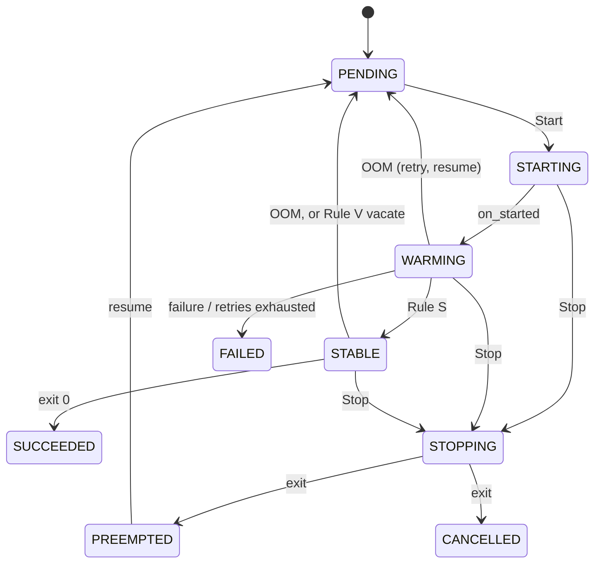

# Concepts

## Resources

`Resources` is an immutable mapping from a dimension name to a non-negative number: `Resources(vram=9, ram=32)`. A missing dimension is 0. rampgate does **not** know units: use GB, MiB or bytes, but use the same unit everywhere for a dimension. `KiB`, `MiB` and `GiB` are exported as byte constants for convenience.

## Device

```python
Device(id, capacity, labels={}, stable_min_usage=Resources())
```

- `capacity`: everything the device has, e.g. a GPU's total memory.
- `labels`: free-form. The history estimator uses `labels["kind"]` to group devices of the same kind.
- `stable_min_usage`: the **Rule S usage floor** (see [Algorithm](algorithm.md#rule-s-stability)). A job that reports no steps is not considered stable on this device before its usage there has exceeded the floor. It is off by default. `rampgate-nvml` sets 256 MiB; without that adapter, set it yourself.

## Job

```python
Job(id, placement, group=None, position=0, priority=0, fingerprint=(), force=False, metadata={})
```

- `placement`: device id → declared hint (`Resources`) or `None`. The caller chooses the devices; rampgate only decides *when*. Several devices make a **gang**, which starts on all of them or none.
- `fingerprint`: keys from most to least specific (e.g. `("resnet50-bs256", "resnet50")`). The history estimator learns peaks per key.
- `force`: skip capacity checks (Rule A), not probation.

## Lifecycle



Each new run of a job is an **attempt**, numbered from 1. Events and actions carry the attempt, so stale events from an earlier attempt are recognized and ignored.

## Events in, actions out

You feed the `Engine` **events**:

- **Facts:** `JobStarted`, `JobExited(kind)`, `JobObserved` (a job's usage on a device), `DeviceObserved` (a device's total usage). Apply a device sample with `observe_sample` (see [Integrating](integrating.md#sampling)).
- **Commands:** `submit`, `update`, `preempt`, `resume`, `cancel`, `pause`, `unpause`, `add_device`, `remove_device`.

`engine.tick(now)` returns a `Decision` with **actions** for your executor:

- `Start`, `Stop`.
- `MarkStable`, `UpdateReservation`, `Requeue`, `Fail`, `GroupCompleted`.
- `Warn` / `WarnCleared`.

Every action has a deterministic `action_id`, so applying it twice is detectable.

## Explanations

`decision.explanations` says why each waiting job waits. Examples:

- `WaitingForWarmup(device, job)`: another job without a trusted estimate is ramping there.
- `InsufficientResources(device, dim, need, available)`.
- `BlockedByForeignUsage`: memory used by processes rampgate does not manage.
- `DeviceHeldFor(device, job)`: an earlier job in the queue, or an isolation retry, holds the device.

## Warnings

Edge-triggered warnings are raised once with `Warn` when their condition starts, and end with `WarnCleared`:

- `CapacityExceeded`, `Overcommitted`, `ForeignUsageHigh`, `HintExceeded`, `Unreconciled`.
- `NoUsageObserved`: a job without steps reached `max_warmup_s` without passing the usage floor.
- `JobNotObserved`: a running job is missing from `Config.missing_samples_warn` samples in a row.

`UncleanStop` and `QueueStopped` are one-shot.
